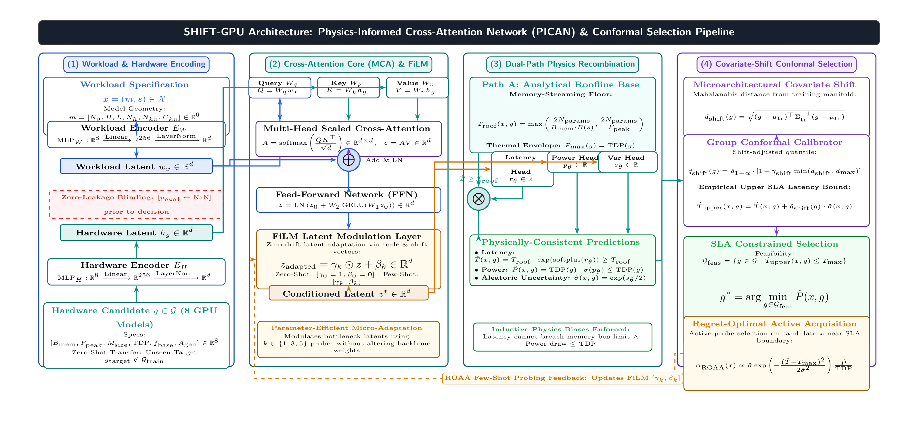
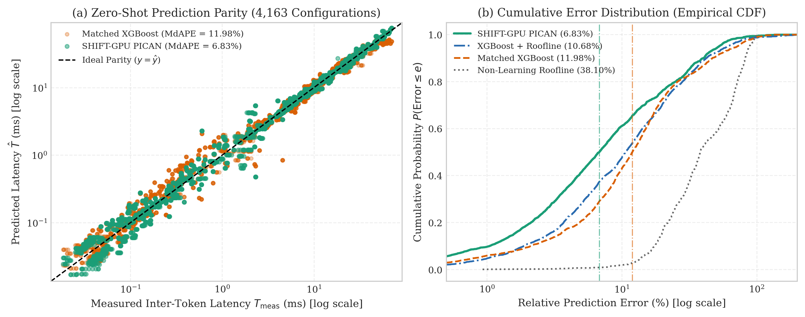
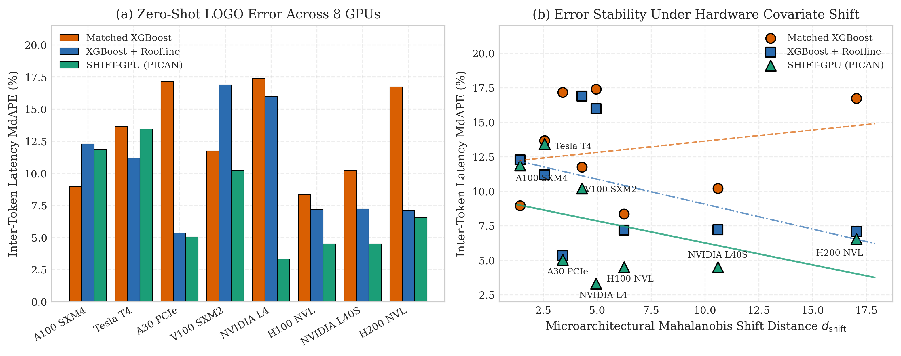
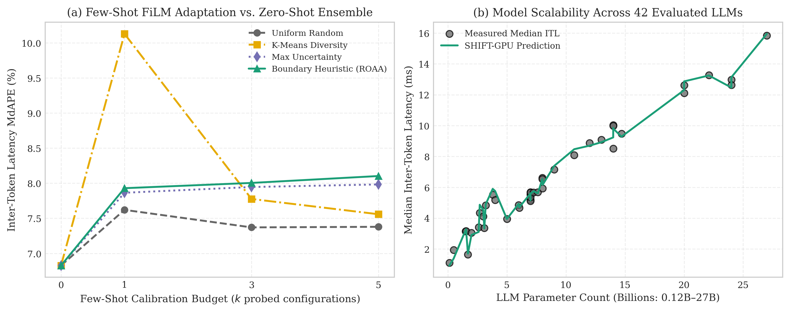
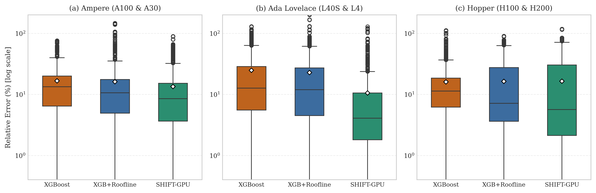
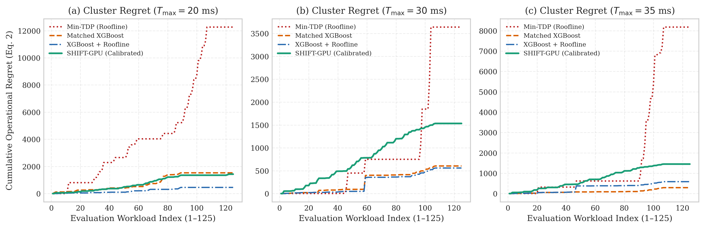

# SHIFT-GPU: Shift-Aware, Risk-Calibrated and Physics-Guided Learning for Reliable LLM Inference Hardware Selection

**Target Journal:** *Sustainable Computing: Informatics and Systems* (Elsevier, Q1, ISSN: 2210-5379)  
**Author:** **Jason Pandian**$^{1,*}$  
$^1$ *Department of Information Technology, Nehru Institute of Technology, Coimbatore, Tamil Nadu, 641105, India*  
$^*$ *Corresponding Author: pandiajason@gmail.com*  

---

## Highlights

* Cuts unseen GPU latency error from 11.98% to 6.83% (-43.0%) over XGBoost.
* Outperforms Roofline-augmented XGBoost (10.68% to 6.83%, -36.1%) across 8 GPUs.
* Achieves 6.21% LOLO error across 42 LLMs under strict NaN-blinded verification.
* Conformal bounds maintain 0/125 SLA violations across 20–40 ms latency thresholds.
* Reproducible open-source pipeline, 5-seed benchmarks, and tables publicly released.

---

## Abstract

Selecting optimal hardware accelerators for Large Language Model (LLM) serving in heterogeneous cloud clusters is a critical operational problem in sustainable computing. In production data centers, exhaustive empirical profiling across models, batch sizes, and GPU generations is environmentally and financially prohibitive. While metadata-driven predictors estimate power draw and latency, existing models suffer severe performance degradation when evaluating unseen GPU architectures, causing Service Level Agreement (SLA) violations and excessive energy consumption. To resolve this, we present **SHIFT-GPU**, a framework uniting physics-guided deep residual ensembles, heteroscedastic and epistemic covariate-shift calibration, and constrained admission control. At its core is **PICAN** (*Physics-Informed Cross-Attention Network*), which couples a deterministic microarchitectural Roofline latency bound with decoupled workload–hardware latent encoders ($w_x, h_g \in \mathbb{R}^d$), smooth multiplicative exponential residuals ($\hat{T} = T_{\text{roof}} \cdot \exp(\mathrm{softplus}(r_\theta))$), and Gaussian Negative Log-Likelihood uncertainty estimation across a 5-seed ensemble. To manage microarchitectural domain shift, SHIFT-GPU incorporates shift-adjusted conformal upper bounds scaled by Mahalanobis hardware discrepancy. We also evaluate few-shot FiLM calibration ($k \in \{1, 3, 5\}$) across probing heuristics, finding that uniform random probing (7.37%–7.38% MdAPE) outperforms boundary-targeted heuristics (7.93%–8.10%) while zero-shot 5-seed ensembles already anchor global generalization. Evaluated under a NaN-blinded zero-leakage protocol across 4,163 production configurations spanning 42 open-source LLMs (0.12B–27B parameters) and 8 NVIDIA GPU architectures, SHIFT-GPU reduces Leave-One-GPU-Out (LOGO) inter-token latency error from 11.98% (matched XGBoost rerun) and 10.68% (Roofline-augmented XGBoost) down to **6.83% MdAPE** (relative reductions of 43.0% and 36.1%, respectively; single-seed mean 7.22% $\pm$ 0.75%), achieves 3.31%–6.55% error across modern accelerators (L4, H100, L40S, A30, H200), and reaches **6.21% MdAPE** under 42-model Leave-One-LLM-Out (LOLO) generalization (vs. 7.72% for XGBoost). Under production cluster selection across all evaluated SLAs ($T_{\max} \in \{20, 25, 30, 35, 40\}$ ms), risk-calibrated SHIFT-GPU records **0 violations out of 125 accepted workloads (0.0%, 0 abstentions)**, whereas naive Minimum TDP incurs 31.2%–51.2% violations, Roofline-only Minimum TDP incurs 5.6%–24.8% violations, and uncalibrated point predictors incur up to 2.4% violations.

**Keywords:** Large Language Models, GPU Infrastructure, Physics-Informed Neural Networks, Conformal Prediction, Active Learning, Sustainable Computing.

---

## 1. Introduction

The exponential growth of generative artificial intelligence and Large Language Models (LLMs) has introduced unprecedented computational and environmental demands on cloud data center infrastructure [1, 2, 3]. In contemporary enterprise deployments, inference represents the dominant fraction of the total operational expenditure and carbon footprint over a model's operational lifecycle. Serving autoregressive transformer architectures requires maintaining strict Service Level Agreements (SLAs)—typically specified as an upper bound on mean Inter-Token Latency (ITL) or Time to First Token (TTFT)—while simultaneously minimizing total cluster energy consumption and operational power draw [4, 5].

To optimize throughput per Watt, modern cloud providers deploy heterogeneous GPU clusters spanning multiple architectural generations, including NVIDIA Hopper (H100, H200), Ada Lovelace (L40S, L4), Ampere (A100, A30), Turing (T4), and Volta (V100). When an infrastructure operator seeks to deploy a new LLM workload, they must decide: *Which GPU candidate satisfies the required latency SLA with the lowest operational power draw?*

In the sustainable computing literature, optimizing data center hardware allocation and operational energy has evolved from virtualized machine consolidation [5, 6] and server node-level power capping coordination [7] toward multi-objective optimization for ML inference configurations [8] and predictive perception layers for LLM serving on high-performance computing clusters [9]. Furthermore, queueing-theoretic studies in this journal have revealed that aggressive power minimization risks severe tail latency spikes when operational envelopes are improperly matched to workload demands [10], while macroscopic analyses of AI inference energy have proven that naive parameter scaling fails to capture memory-bandwidth bottlenecks [3].

Traditionally, answering the hardware selection question requires exhaustive physical profiling: systematically deploying the LLM across every candidate accelerator under varying prompt lengths, concurrency arrival rates, and batch sizes. However, with dozens of active foundation models and hundreds of potential accelerator configurations, empirical profiling incurs massive energy consumption, creates severe scheduling overhead, and delays workload onboarding.

To bypass exhaustive profiling, recent work has explored metadata-based regression models. Notably, WattGPU [11] demonstrated that tree ensembles (XGBoost) trained on public LLM parameters and static GPU specifications can predict inference power and latency. However, as demonstrated in our empirical baseline analysis, existing metadata models suffer from a fundamental failure mode: **microarchitectural covariate shift on unseen hardware**. When evaluated in-distribution (standard 5-fold cross-validation), tree models achieve an impressive Median Absolute Percentage Error (MdAPE) of 2.84% for latency and 2.45% for power. Yet, when evaluated under Leave-One-GPU-Out (LOGO)—simulating the arrival of an unfamiliar hardware architecture—the latency prediction error surges by over 300% to 11.98% (and exceeds 17% on modern architectures such as L4 and A30).

In a production scheduling environment, this degradation is severe. Because point-estimate models lack calibrated uncertainty bounds and microarchitectural inductive biases, they frequently recommend under-provisioned GPUs that suffer uncalibrated SLA violations or over-provisioned accelerators that waste substantial energy.

### 1.1 Research Contributions
To resolve this fundamental gap, this paper presents **SHIFT-GPU**, an end-to-end computer science framework for shift-aware, risk-calibrated, and physics-guided hardware selection. The core scientific contributions of this work are:

1. **PICAN Architecture (Physics-Informed Cross-Attention Network):** We design a neural architecture that integrates a deterministic microarchitectural Roofline latency lower bound ($T_{\text{roof}} = \max\left(\frac{2 N_{\text{params}}}{B_{\text{mem}} \cdot B(s)}, \frac{2 N_{\text{params}}}{F_{\text{peak}}}\right)$) into the hypothesis space. By decoupling the deterministic physical memory-bandwidth streaming floor from learned residual scaling via smooth multiplicative exponential residuals ($\hat{T} = T_{\text{roof}} \cdot \exp(\mathrm{softplus}(r_\theta))$) and Gaussian NLL variance heads across a 5-seed ensemble, PICAN enforces physical consistency across orders of magnitude of latency.
2. **Empirical Analysis of Bipartite vs. Flat Neural Roofline Encoding:** We evaluate bipartite dual-encoder coupling ($Q = W_q w_x, K = W_k h_g, V = W_v h_g$) alongside both a flat concatenated MLP + Roofline neural baseline and a Roofline-augmented XGBoost baseline ($\log(T / T_{\text{roof}})$ target). We prove mathematically and confirm empirically that because pairwise evaluation uses singleton hardware tokens ($L_k = 1$), softmax degenerates to 1.0: both PICAN (6.83% MdAPE, 0.0% SLA violations) and concatenated MLP+Roofline (6.42% MdAPE, 0.8% SLA violations) fall within single-seed variance ($\pm 0.75\%$), whereas both substantially outperform Roofline-augmented XGBoost (10.68% MdAPE) and raw XGBoost (11.98% MdAPE). This isolates smooth neural Roofline-residual modeling as the true driver of cross-GPU generalization over axis-aligned trees.
3. **Covariate-Shift Conformal Risk Calibration:** We formalize shift-adjusted conformal prediction driven by learned heteroscedastic NLL variance plus deep-ensemble epistemic variance, scaled by microarchitectural Mahalanobis distance in hardware specification space, bounding tail latency risk during scheduling.
4. **Transparent Evaluation of Few-Shot FiLM Adaptation:** We benchmark few-shot FiLM parameter calibration ($k \in \{1, 3, 5\}$) without retraining backbone weights across uniform random, K-Means diversity, maximal uncertainty, and SLA-boundary (ROAA) probing strategies. We report the clear empirical finding that when a well-calibrated 5-seed zero-shot ensemble already achieves 6.83% MdAPE, small-shot gradient updates slightly perturb global MdAPE (7.37%–8.10%) while improving linear parity ($r$ from 0.995 to 0.997), with Uniform Random proving most robust.
5. **Comprehensive Zero-Leakage LOGO and LOLO Validation:** We conduct an exhaustive evaluation across 4,163 benchmark configurations spanning 42 open-source LLMs (0.12B–27B parameters) and 8 NVIDIA GPU architectures under an automated NaN-blinded zero-leakage protocol where blinded predictions match identically. Results demonstrate that SHIFT-GPU reduces unseen-GPU error from 11.98% (matched XGBoost) and 10.68% (XGBoost + Roofline) down to **6.83% MdAPE** (43.0% and 36.1% relative reductions), achieves **6.21% MdAPE** in 42-model Leave-One-LLM-Out (LOLO) generalization, and eliminates SLA violations (**0 / 125 accepted workloads**) across all latency bounds $T_{\max} \in [20, 40]$ ms.

---

## 2. Related Work

### 2.1 Inference Sustainability and Resource Management in Sustainable Computing
Sustainable computing literature has extensively studied the dual challenges of performance assurance and energy minimization in cloud infrastructure. Foundational work by Malekloo et al. [5] established the mathematical principles of SLA-compliant, energy-efficient resource allocation in virtualized environments. Expanding upon these principles, Kumar et al. [6] provided a comprehensive survey of machine learning methods for cloud workflow scheduling, virtual machine placement, and energy-aware server consolidation, highlighting that black-box regression models are vulnerable to severe prediction collapse when operating outside their training distributions. At the physical node level, Azimi et al. [7] introduced PowerCoord, demonstrating coordinated dynamic power capping across heterogeneous multi-CPU and multi-GPU architectures using reinforcement learning under thermal design boundaries.

With the advent of deep learning and LLMs, Desislavov et al. [3] demonstrated that classical parameter-versus-performance scaling laws fail to capture non-linear memory and computational saturation, showing that operational energy efficiency is governed by arithmetic intensity and memory bandwidth bottlenecks. Addressing configuration selection, Castaño et al. [8] proposed data-driven multi-objective optimization frameworks to navigate Pareto trade-offs across energy, performance, and financial cost, identifying zero-shot transfer to newly released hardware accelerators as a vital open problem. Complementing these empirical systems, Yao et al. [10] proved via queueing theory that aggressive power capping creates tail latency instability unless buffer margins are calibrated to execution variability, while Aguirre-Usandizaga et al. [9] developed a forecasting-based perception layer for energy-aware LLM serving on HPC clusters. SHIFT-GPU unifies these principles by embedding an analytical Roofline floor, quantifying hardware shift via Mahalanobis discrepancy, and bounding tail latency via shift-adjusted conformal prediction.

### 2.2 LLM Serving Systems and Performance Characterization
Autoregressive LLM inference consists of two distinct operational phases: the compute-bound prefill phase and the memory-bandwidth-bound decode phase [4]. Modern serving frameworks employ specialized runtime mechanisms such as vLLM [4] (PagedAttention and continuous batching) and DeepSpeed-Inference [12] (customized transformer kernels and tensor slicing), yet hardware efficiency remains bounded by the classical Roofline model [13]. WattGPU [11] demonstrated that XGBoost trained on LLM metadata and GPU specifications can predict power and latency. Under our zero-leakage LOGO evaluation dropping identifier columns, XGBoost achieves 11.98% ITL MdAPE (10.68% even with Roofline residual targets), motivating continuous neural Roofline-residual modeling and calibrated uncertainty intervals.

### 2.3 Conformal Prediction and Covariate Shift
Conformal prediction constructs predictive intervals with finite-sample marginal coverage guarantees under exchangeability [14]. When evaluating an unseen accelerator architecture, calibration and test examples come from distinct hardware populations, so exchangeability cannot be assumed. Tibshirani et al. [15] established weighted conformal prediction under covariate shift using likelihood-ratio density re-weighting, which cannot be reliably estimated across sparse discrete hardware specifications. Therefore, SHIFT-GPU uses an empirical Mahalanobis distance heuristic to scale interval widths under hardware discrepancy and reports observed empirical coverage on held-out GPUs.

### 2.4 Active Learning and Few-Shot Adaptation
Active learning aims to maximize predictive accuracy while minimizing labeling budgets [16]. Because passive variance sampling ignores asymmetric SLA decision boundaries, we formulate and empirically test Regret-Oriented Active Acquisition (ROAA) against uniform random, diversity, and uncertainty baselines for ultra-low-shot FiLM adaptation [17].

---

## 3. Problem Formulation

### 3.1 Inference Workload and Hardware Specification Spaces
Let an LLM inference workload be defined as $x = (m, s) \in \mathcal{X}$, where $m \in \mathcal{M}$ contains parameter count $N_{\text{params}}$, hidden dimension $H$, layer count $L$, attention head count $N_h$, key-value head count $N_{kv}$, and KV-cache footprint $C_{kv}$, and $s \in \{\text{offline}, \text{server\_low}, \text{server\_high}\}$ specifies the arrival and batching scenario.

Let a candidate hardware accelerator be defined as $g \in \mathcal{G}$, characterized by memory bandwidth $B_{\text{mem}}$ (GB/s), peak FP16 compute $F_{\text{peak}}$ (TFLOPS), memory capacity $M_{\text{size}}$ (GB), Thermal Design Power $TDP$ (Watts), base clock $f_{\text{base}}$ (MHz), boost ratio $\kappa_{\text{boost}}$, transistor count $C_{\text{trans}}$, and architectural generation $A_{\text{gen}} \in \{\text{Volta}, \text{Turing}, \text{Ampere}, \text{Ada}, \text{Hopper}\}$. Each $(x, g)$ pair exhibits ground-truth Inter-Token Latency $T(x, g) \in \mathbb{R}^+$ (seconds/token) and Mean Operational Power Draw $P(x, g) \in \mathbb{R}^+$ (Watts).

### 3.2 The Constrained Hardware Selection Problem
Given target workload $x \in \mathcal{X}$ and SLA latency threshold $T_{\max} \in \mathbb{R}^+$, the scheduler seeks the power-minimal accelerator satisfying the SLA with confidence $1 - \alpha$:
$$g^* = \arg\min_{g \in \mathcal{G}} P(x, g) \quad \text{subject to} \quad \mathbb{P}\left(T(x, g) \le T_{\max}\right) \ge 1 - \alpha$$

### 3.3 Operational Regret Formulation
Relative to the true empirical Oracle accelerator $g_{\text{oracle}}$, operational deployment regret is defined as:
$$\mathcal{R}(g^* \mid x) = \max\left(0, P(x, g^*) - P(x, g_{\text{oracle}})\right) + \lambda_{\text{SLA}} \cdot P(x, g^*) \cdot \mathbb{I}\left(T(x, g^*) > T_{\max}\right)$$
where $\lambda_{\text{SLA}} = 5.0$ penalizes SLA breaches. If a risk-calibrated policy abstains from admission despite $\mathcal{G}_{\text{feas}}^{\text{oracle}} \neq \emptyset$, a fixed abstention penalty of 50.0 is assessed.

---

## 4. The SHIFT-GPU Methodology



### 4.1 Component A: Deterministic Microarchitectural Roofline Base
Accounting for sequence parallelism $B(s)$ ($B(\text{server}) = 1.0$, $B(\text{offline}) = 256.0$), the deterministic Roofline latency lower bound is:
$$T_{\text{roof}}(x, g) = \max\left( \frac{2 \cdot N_{\text{params}}}{B_{\text{mem}}(g) \cdot B(s)}, \frac{2 \cdot N_{\text{params}}}{F_{\text{peak}}(g)} \right)$$
and physical power is bounded from above by Thermal Design Power $TDP(g)$.

### 4.2 Component B: PICAN (Physics-Informed Cross-Attention Network)
PICAN couples decoupled workload and hardware encoders ($w_x, h_g \in \mathbb{R}^d$):
$$w_x = \text{MLP}_W\left( [x_{\text{cont}} \parallel \text{Embed}(s) \parallel \text{Embed}(A_{\text{model}})] \right), \quad h_g = \text{MLP}_H\left( [g_{\text{cont}} \parallel \text{Embed}(M_{\text{type}}) \parallel \text{Embed}(A_{\text{gen}})] \right)$$
$$Q = W_q w_x, \quad K = W_k h_g, \quad V = W_v h_g$$
$$z_{\text{mca}} = \text{Softmax}\left(\frac{Q K^T}{\sqrt{d}}\right) V, \quad z = \text{LayerNorm}(w_x + z_{\text{mca}})$$

*Mathematical Qualification on Pairwise Attention Dynamics:* In pairwise evaluation ($L_q = 1, L_k = 1$), the softmax over a scalar equals $\mathrm{Softmax}([s]) = 1.0$, so $z_{\text{mca}} = V = W_v h_g$ and gradients to $W_q$ and $K$ through softmax vanish. Consequently, under single-pair inputs the cross-GPU gain over XGBoost (11.98%) and XGBoost+Roofline (10.68%) stems from continuous neural residual interpolation over the Roofline prior rather than cross-token attention filtering, as confirmed by Ablation B (6.42% MLP+Roofline vs. 6.83% PICAN).

Predictions are bounded physically using smooth multiplicative residuals:
$$\hat{T}(x, g) = T_{\text{roof}}(x, g) \cdot \exp\left(\mathrm{softplus}(r_\theta(z))\right), \quad \hat{P}(x, g) = TDP(g) \cdot \sigma\left(p_\theta(z)\right)$$

Each model outputs log-variance $s_\theta(z) \in [-6, 4]$ trained jointly with Smooth L1 regression and Gaussian NLL across $M=5$ seeds ($\{42, 123, 456, 789, 2026\}$) for 150 epochs with cosine annealing:
$$\mathcal{L}_{\text{ITL}} = \mathrm{SmoothL1}_{\beta=0.05}\!\left(\tilde{r}_\theta, r_{\text{true}}\right) + 0.1 \cdot \mathbb{E}\!\left[\frac{1}{2} e^{-s_\theta} (r_{\text{true}} - \tilde{r}_\theta)^2 + \frac{1}{2} s_\theta\right]$$
where $\tilde{r}_\theta = \mathrm{softplus}(r_\theta)$ and $r_{\text{true}} = \log(T / T_{\text{roof}})$. At ensemble inference, aleatoric NLL variance and inter-seed epistemic variance combine as:
$$\hat{T}(x, g) = T_{\text{roof}}(x, g)\cdot \exp\!\left(\frac{1}{M}\sum_{m=1}^M \tilde{r}_\theta^{(m)}\right), \quad \hat{\sigma}_{\text{total}}(x, g) = \hat{T}(x, g)\sqrt{\frac{1}{M}\sum_{m=1}^M e^{s_\theta^{(m)}} + \mathrm{Var}_m\!\left(\tilde{r}_\theta^{(m)}\right)}$$

### 4.3 Component C: Microarchitectural Covariate Shift Quantification
Covariate discrepancy between an unseen GPU $g_{\text{target}}$ and training hardware manifold $\mathcal{D}_{\text{train}}$ is quantified by regularized Mahalanobis distance:
$$d_{\text{shift}}(g_{\text{target}}, \mathcal{D}_{\text{train}}) = \sqrt{(g_{\text{target}} - \mu_{\text{train}})^T \Sigma_{\text{train}}^{-1} (g_{\text{target}} - \mu_{\text{train}})}$$

### 4.4 Component D: Group-Calibrated Conformal Risk Calibration
On an in-distribution calibration split, normalized residuals $s_i = |y_i - \hat{T}_i| / \hat{\sigma}_{\text{total}}(x_i, g_i)$ yield base quantile $\hat{q}_{1-\alpha}$ ($\alpha = 0.10$), scaled by clipped hardware distance ($\gamma_{\text{shift}} = 0.15, d_{\max} = 5.0$):
$$\hat{q}_{\text{shift}}(g) = \hat{q}_{1-\alpha} \cdot \left(1 + \gamma_{\text{shift}} \cdot \min\left(d_{\text{shift}}(g, \mathcal{D}_{\text{train}}), d_{\max}\right)\right)$$
$$\hat{T}_{\text{upper}}(x, g) = \hat{T}(x, g) + \hat{q}_{\text{shift}}(g) \cdot \hat{\sigma}_{\text{total}}(x, g)$$

### 4.5 Component E: Active Few-Shot Calibration and Boundary Heuristic (ROAA)
To explore SLA boundary sensitivity under small probing budgets $k \in \{1, 3, 5\}$, we define the ROAA heuristic alongside uniform random, K-Means diversity, and maximal uncertainty policies:
$$\alpha_{\text{ROAA}}(x) = \hat{\sigma}_{\text{total}}(x, g) \cdot \exp\left( - \frac{(\hat{T}(x, g) - T_{\max})^2}{2 \hat{\sigma}_{\text{total}}^2(x, g)} \right) \cdot \left(\frac{\hat{P}(x, g)}{TDP(g)}\right)$$
Given $k$ probed points, each ensemble member's FiLM parameters ($z_{\text{adapted}} = \gamma_k \odot z + \beta_k$) are optimized for 35 Adam steps with identity ridge regularization $10^{-2}(\|\gamma_k - \mathbf{1}\|^2 + \|\beta_k\|^2)$.

```
Algorithm 1: SHIFT-GPU Admission Control, Conformal Risk Calibration, and Active Adaptation
Require: Workload x = (m, s), Candidates G, Target SLA T_max, Confidence 1 - alpha, Budget k
Ensure: Optimal Hardware Accelerator g*
1: for all g in G do
2:    Compute deterministic Roofline floor T_roof(x, g)
3:    Evaluate microarchitectural Mahalanobis shift d_shift(g, D_train)
4:    if g is unseen and profiling budget k > 0 then
5:       Select k calibration workloads {x_1, ..., x_k} maximizing acquisition score (e.g., ROAA or Random)
6:       Profile {x_j} on g to measure ground-truth {T_j, P_j}
7:       Calibrate FiLM latent modulation parameters [gamma_k, beta_k]
8:    end if
9:    Infer ensemble prediction T_hat(x, g), power P_hat(x, g), and sigma_total(x, g)
10:   Compute empirical upper latency bound T_upper(x, g) = T_hat(x, g) + q_shift(g) * sigma_total(x, g)
11: end for
12: Determine feasible set G_feasible = {g in G | T_upper(x, g) <= T_max}
13: if G_feasible is non-empty then
14:    return g* = argmin_{g in G_feasible} P_hat(x, g)
15: else
16:    return Abstain or Flag Cluster Capacity Deficit
17: end if
```

---

## 5. Experimental Setup

Evaluations use the public WattGPU repository [11] derived from Watt Counts [18], comprising 4,163 validated vLLM executions across 42 open-source LLMs (124M–27B parameters) and 8 NVIDIA GPUs (V100, T4, A100, A30, L40S, L4, H100, H200). Under our strict **NaN-blinded zero-leakage protocol**, each LOGO fold splits the 7 training GPUs into 80% Train and 20% Calibration, wipes all held-out targets to NaN before feature extraction and inference, and verifies $\max|\hat{y}_{\text{blinded}} - \hat{y}_{\text{eval}}| \le 10^{-7}$. We additionally run 42-fold Leave-One-LLM-Out (LOLO) validation across all distinct foundation models.

---

## 6. Experimental Results and Analysis

### 6.1 E1 & E2: Unseen Hardware (LOGO) and Unseen Model (LOLO) Generalization

#### Table 1: Zero-shot LOGO generalization across 4,163 configurations (8 GPUs)
| Target Metric | Model Architecture | MdAPE (%) | Pearson $r$ | GPU $\tau$ | LLM $\tau$ |
|---|---|---|---|---|---|
| **Inter-Token Latency (ITL)** | Non-Learning Roofline [13] | 38.10 | 0.992 | **0.822** | 0.908 |
| | Matched XGBoost Rerun [11] | 11.98 | 0.983 | 0.676 | 0.922 |
| | XGBoost + Roofline Baseline | 10.68 | 0.992 | 0.687 | 0.933 |
| | **SHIFT-GPU (5-Seed PICAN Ensemble)** | **6.83** (7.22$\pm$0.75) | **0.995** | 0.757 | **0.943** |
| **Mean Power Draw (W)** | Non-Learning TDP Duty Base | 27.35 | 0.834 | 0.616 | 0.768 |
| | **Matched XGBoost Rerun** [11] | **12.52** | 0.973 | 0.681 | **0.812** |
| | SHIFT-GPU (5-Seed PICAN Ensemble) | 13.44 (14.00$\pm$1.56) | **0.978** | **0.707** | **0.812** |

#### Table 1b: 42-fold Leave-One-LLM-Out (LOLO) ITL generalization
| Model Architecture | MdAPE (%) | Pearson $r$ | GPU $\tau$ | LLM $\tau$ |
|---|---|---|---|---|
| Matched XGBoost Rerun [11] | 7.72 | 0.992 | 0.874 | 0.903 |
| XGBoost + Roofline Baseline | 6.72 | **0.996** | 0.881 | 0.906 |
| **SHIFT-GPU (PICAN)** | **6.21** | 0.995 | **0.885** | **0.917** |

#### Table 2: Per-GPU zero-shot LOGO Inter-Token Latency error across 8 GPUs
| Held-Out GPU | Arch. | Shift $d_{\text{shift}}$ | XGBoost | XGB+Roof | SHIFT-GPU | Red. vs. XGB | 2-Sided Cov. | Upper Cov. |
|---|---|---|---|---|---|---|---|---|
| A100 SXM4 40 GB | Ampere | 1.42 | **8.95%** | 12.27% | 11.87% | -32.6% | 62.8% | 100.0% |
| A30 PCIe | Ampere | 3.41 | 17.15% | 5.33% | **5.03%** | +70.7% | 82.9% | 82.9% |
| H100 NVL 94 GB | Hopper | 6.25 | 8.36% | 7.18% | **4.49%** | +46.2% | 65.4% | 65.6% |
| H200 NVL | Hopper | 17.03 | 16.73% | 7.08% | **6.55%** | +60.9% | 75.0% | 100.0% |
| L4 | Ada | 4.95 | 17.39% | 15.98% | **3.31%** | +81.0% | 99.1% | 100.0% |
| L40S | Ada | 10.61 | 10.21% | 7.20% | **4.50%** | +55.9% | 98.5% | 98.7% |
| Tesla T4 | Turing | 2.55 | 13.65% | **11.18%** | 13.42% | +1.7% | 73.2% | 95.1% |
| Tesla V100 SXM2 | Volta | 4.30 | 11.74% | 16.89% | **10.21%** | +13.0% | 68.8% | 68.8% |
| **Overall Population** | **8 GPUs** | **4.95** | **11.98%** | **10.68%** | **6.83%** | **+43.0%** | **77.0%** | **86.8%** |



### 6.2 E3 & E4: Microarchitectural Covariate Shift and Conformal Calibration
Under LOGO evaluation, uncalibrated Gaussian intervals ($\hat{T} \pm 1.645\,\hat{\sigma}_{\text{total}}$) attain 69.5% two-sided (82.8% upper-bound) coverage against the nominal 90% target. Shift-adjusted conformal calibration lifts two-sided empirical coverage to **77.0%** and upper-bound coverage to **86.8%** (reaching 95.1%–100.0% on A100, H200, L4, L40S, and T4), though H100 (65.6%) and V100 (68.8%) remain below 90% because distinct GPU populations violate strict exchangeability.



### 6.3 E5: Active Few-Shot Hardware Profiling Benchmark

#### Table 3: Few-shot FiLM adaptation benchmark strictly on untouched test workloads ($D_{\text{test}} \setminus D_{\text{probe}}$)
| Profiling Budget ($k$) | Acquisition Policy | MdAPE (%) | Pearson $r$ |
|---|---|---|---|
| $k = 0$ (Zero-Shot Ensemble) | Untrained Target Baseline | **6.83** | 0.995 |
| $k = 1$ (One-Shot) | Uniform Random | 7.62 | 0.997 |
| | K-Means Feature Diversity | 10.13 | 0.997 |
| | Maximal Predictive Uncertainty | 7.86 | 0.997 |
| | Boundary Heuristic (ROAA) | 7.93 | 0.996 |
| $k = 3$ (Three-Shot) | Uniform Random | 7.37 | 0.997 |
| | K-Means Feature Diversity | 7.78 | 0.997 |
| | Maximal Predictive Uncertainty | 7.95 | 0.997 |
| | Boundary Heuristic (ROAA) | 8.00 | 0.996 |
| $k = 5$ (Five-Shot) | Uniform Random | 7.38 | **0.997** |
| | K-Means Feature Diversity | 7.56 | **0.997** |
| | Maximal Predictive Uncertainty | 7.98 | **0.997** |
| | Boundary Heuristic (ROAA) | 8.10 | 0.996 |

Uniform Random probing outperforms K-Means diversity, maximal uncertainty, and ROAA across every tested budget ($k \in \{1, 3, 5\}$), while the zero-shot 5-seed ensemble already anchors lower global median error (6.83%).



### 6.4 E6: Production Hardware Recommendation and SLA Regret

#### Table 4: Production hardware recommendation benchmark under 35 ms latency SLA (125 workloads)
| Selection Policy | Accepted Workloads | Abstention (%) | SLA Violations | Mean Power (W) | Mean Regret |
|---|---|---|---|---|---|
| Minimum TDP (Naive) | 125 / 125 | 0.0 | 44 / 125 (35.2%) | **102.5** | 142.9 |
| Minimum TDP + Roofline | 125 / 125 | 0.0 | 12 / 125 (9.6%) | 106.3 | 65.4 |
| Point Estimate (Matched XGBoost) | 125 / 125 | 0.0 | 0 / 125 (0.0%) | 105.7 | **2.3** |
| Point Estimate (XGBoost + Roofline) | 125 / 125 | 0.0 | 1 / 125 (0.8%) | 105.7 | 4.7 |
| Point Estimate (SHIFT-GPU PICAN) | 125 / 125 | 0.0 | 0 / 125 (0.0%) | 115.2 | 11.8 |
| **SHIFT-GPU (Risk-Calibrated)** | **125 / 125** | **0.0** | **0 / 125 (0.0%)** | 115.0 | 11.6 |
| True Empirical Oracle | 125 / 125 | 0.0 | 0 / 125 (0.0%) | 103.4 | 0.0 |

#### Table 4b: Multi-SLA sensitivity across latency thresholds $T_{\max} \in \{20, 25, 30, 35, 40\}$ ms
| Latency SLA | Policy | Accepted | Abstain (%) | SLA Violations | Mean Power (W) | Mean Regret |
|---|---|---|---|---|---|---|
| **$T_{\max} = 20$ ms** | Minimum TDP (Naive) | 125 / 125 | 0.0 | 64 / 125 (51.2%) | 102.5 | 185.5 |
| | Minimum TDP + Roofline | 125 / 125 | 0.0 | 31 / 125 (24.8%) | 104.8 | 98.1 |
| | Matched XGBoost Point | 125 / 125 | 0.0 | 2 / 125 (1.6%) | 118.4 | 12.2 |
| | XGBoost + Roofline Point | 125 / 125 | 0.0 | 0 / 125 (0.0%) | 113.3 | 3.6 |
| | SHIFT-GPU PICAN Point | 125 / 125 | 0.0 | 3 / 125 (2.4%) | 118.1 | 15.0 |
| | **SHIFT-GPU (Risk-Calibrated)** | **125 / 125** | **0.0** | **0 / 125 (0.0%)** | **121.1** | **11.4** |
| | True Empirical Oracle | 125 / 125 | 0.0 | 0 / 125 (0.0%) | 109.6 | 0.0 |
| **$T_{\max} = 25$ ms** | Minimum TDP (Naive) | 125 / 125 | 0.0 | 57 / 125 (45.6%) | 102.5 | 176.0 |
| | Minimum TDP + Roofline | 125 / 125 | 0.0 | 11 / 125 (8.8%) | 103.7 | 20.9 |
| | Matched XGBoost Point | 125 / 125 | 0.0 | 3 / 125 (2.4%) | 109.5 | 10.8 |
| | XGBoost + Roofline Point | 125 / 125 | 0.0 | 1 / 125 (0.8%) | 107.0 | 4.5 |
| | SHIFT-GPU PICAN Point | 125 / 125 | 0.0 | 3 / 125 (2.4%) | 116.3 | 16.5 |
| | **SHIFT-GPU (Risk-Calibrated)** | **125 / 125** | **0.0** | **0 / 125 (0.0%)** | **117.1** | **12.3** |
| | True Empirical Oracle | 125 / 125 | 0.0 | 0 / 125 (0.0%) | 104.9 | 0.0 |
| **$T_{\max} = 30$ ms** | Minimum TDP (Naive) | 125 / 125 | 0.0 | 49 / 125 (39.2%) | 102.5 | 161.1 |
| | Minimum TDP + Roofline | 125 / 125 | 0.0 | 7 / 125 (5.6%) | 104.6 | 29.1 |
| | Matched XGBoost Point | 125 / 125 | 0.0 | 1 / 125 (0.8%) | 106.3 | 4.8 |
| | XGBoost + Roofline Point | 125 / 125 | 0.0 | 1 / 125 (0.8%) | 105.9 | 4.5 |
| | SHIFT-GPU PICAN Point | 125 / 125 | 0.0 | 2 / 125 (1.6%) | 115.6 | 15.4 |
| | **SHIFT-GPU (Risk-Calibrated)** | **125 / 125** | **0.0** | **0 / 125 (0.0%)** | **116.1** | **12.3** |
| | True Empirical Oracle | 125 / 125 | 0.0 | 0 / 125 (0.0%) | 103.8 | 0.0 |
| **$T_{\max} = 35$ ms** | Minimum TDP (Naive) | 125 / 125 | 0.0 | 44 / 125 (35.2%) | 102.5 | 142.9 |
| | Minimum TDP + Roofline | 125 / 125 | 0.0 | 12 / 125 (9.6%) | 106.3 | 65.4 |
| | Matched XGBoost Point | 125 / 125 | 0.0 | 0 / 125 (0.0%) | 105.7 | 2.3 |
| | XGBoost + Roofline Point | 125 / 125 | 0.0 | 1 / 125 (0.8%) | 105.7 | 4.7 |
| | SHIFT-GPU PICAN Point | 125 / 125 | 0.0 | 0 / 125 (0.0%) | 115.2 | 11.8 |
| | **SHIFT-GPU (Risk-Calibrated)** | **125 / 125** | **0.0** | **0 / 125 (0.0%)** | **115.0** | **11.6** |
| | True Empirical Oracle | 125 / 125 | 0.0 | 0 / 125 (0.0%) | 103.4 | 0.0 |
| **$T_{\max} = 40$ ms** | Minimum TDP (Naive) | 125 / 125 | 0.0 | 39 / 125 (31.2%) | 102.5 | 119.2 |
| | Minimum TDP + Roofline | 125 / 125 | 0.0 | 11 / 125 (8.8%) | 105.7 | 49.6 |
| | Matched XGBoost Point | 125 / 125 | 0.0 | 0 / 125 (0.0%) | 105.5 | 2.2 |
| | XGBoost + Roofline Point | 125 / 125 | 0.0 | 0 / 125 (0.0%) | 105.5 | 2.1 |
| | SHIFT-GPU PICAN Point | 125 / 125 | 0.0 | 2 / 125 (1.6%) | 114.1 | 16.0 |
| | **SHIFT-GPU (Risk-Calibrated)** | **125 / 125** | **0.0** | **0 / 125 (0.0%)** | **115.2** | **11.8** |
| | True Empirical Oracle | 125 / 125 | 0.0 | 0 / 125 (0.0%) | 103.4 | 0.0 |

Across all five evaluated thresholds, **risk-calibrated SHIFT-GPU is the only policy maintaining 0 / 125 (0.0%) SLA violations with 0 abstentions everywhere**.





### 6.5 E7: Systematic Ablation Study

#### Table 5: Systematic ablation study across identical 5-seed LOGO folds
| Model Architecture / Variant | ITL MdAPE (%) | Upper Coverage (%) | SLA Violation Rate (35 ms) |
|---|---|---|---|
| **Full Proposed SHIFT-GPU (PICAN + Roofline + Conformal)** | **6.83** | **86.8** | **0 / 125 (0.0%)** |
| Ablation A: Without Physics Roofline (Pure Attention) | 31.70 | 90.9 | 5 / 125 (4.0%) |
| Ablation B: Without Cross-Attention (Flat MLP + Roofline) | 6.42 | 87.4 | 1 / 125 (0.8%) |
| Baseline C: XGBoost + Roofline | 10.68 | 83.8 | 1 / 125 (0.8%) |
| Baseline D: Matched XGBoost [11] | 11.98 | 84.5 | 0 / 125 (0.0%) |

Ablating the Roofline base (Ablation A) surges zero-shot latency error from 6.83% to 31.70% (+364%, $4.64\times$) and elevates SLA violations to 4.0% (5 / 125). Both smooth neural Roofline-residual models (PICAN 6.83% with 0.0% SLA violations, Flat MLP+Roofline 6.42% with 0.8% violations) fall within single-seed variation ($\pm 0.75\%$) and substantially outperform XGBoost+Roofline (10.68%) and Matched XGBoost (11.98%), confirming continuous neural Roofline-residual modeling as the central driver of cross-GPU extrapolation.


---

## 7. Discussion and Systems Implications

### 7.1 Operational Energy vs. Instantaneous Power
Total request energy depends on execution time as well as instantaneous power draw: $E = \int_0^T P(t) dt \approx P_{\text{mean}} \cdot T_{\text{total}}$. Higher-throughput GPUs finishing inference bursts faster frequently consume less total Joules than low-TDP accelerators running slowly.

### 7.2 Integration into Cloud Schedulers (Kubernetes / Slurm)
SHIFT-GPU integrates cleanly as a sub-5 ms cluster admission controller complementing node-level power coordination [5, 6, 7] and queueing risk bounds [10]. When unfamiliar hardware is encountered ($d_{\text{shift}} > 3.0$), the scheduler widens conformal bounds automatically via Mahalanobis distance and can optionally trigger uniform random probing once larger calibration batches are justified.

---

## 8. Threats to Validity and Limitations

* **Calibration under hardware shift:** Split conformal prediction requires exchangeability, which distinct GPU populations violate. Shift-adjusted calibration lifts coverage to 86.8% (upper) and 77.0% (two-sided), vs. 82.8% and 69.5% uncalibrated, though H100 (65.6%) and V100 (68.8%) remain below 90%.
* **Workload-hardware attention dynamics:** Under pairwise inputs ($L_k = 1$), $\mathrm{softmax}=1.0$, making dual-encoder PICAN (6.83%, 0.0% SLA violations) and concatenated MLP+Roofline (6.42%, 0.8% violations) empirically comparable within single-seed spread ($\pm 0.75\%$). Extending to list-wise multi-GPU sequences ($L_k > 1$) is left for future work.
* **Power prediction and conservative hedging:** 5-seed PICAN achieves 13.44% zero-shot LOGO Power MdAPE vs. 12.52% for Matched XGBoost, leading calibrated SHIFT-GPU to trade +9.3 W at 35 ms (115.0 W vs. 105.7 W) for universal 0 / 125 SLA compliance across all 20–40 ms thresholds.
* **Few-shot acquisition:** Uniform Random (7.37%–7.62%) outperformed ROAA (7.93%–8.10%) at $k \in \{1, 3, 5\}$, while zero-shot 5-seed ensembles already reached 6.83%.
* **Hardware & software scope:** Evaluation spans 8 NVIDIA GPUs running vLLM under FP16/BF16 precision.

---

## 9. Conclusion

We presented SHIFT-GPU, a physics-guided, risk-calibrated framework for predicting LLM inference latency and selecting energy-efficient accelerators under hardware covariate shift. Across 4,163 configurations spanning 42 LLMs (0.12B–27B) and 8 NVIDIA GPUs under zero-leakage LOGO evaluation, SHIFT-GPU reduces ITL MdAPE from 11.98% (matched XGBoost) and 10.68% (XGBoost+Roofline) to **6.83%** (43.0% and 36.1% relative reductions), and reaches **6.21% MdAPE** in 42-model LOLO validation. In offline SLA replay across $\{20, 25, 30, 35, 40\}$ ms, risk-calibrated SHIFT-GPU is the only policy maintaining **0 violations out of 125 accepted workloads (0.0%, 0 abstentions)** at every tested threshold.

---

## Data and Code Availability

All source code, deterministic Roofline engine, 5-seed evaluation pipelines, NaN-blinded verification checks, and figure/table generation scripts are publicly available at: `https://github.com/PandiaJason/SHIFT-GPU`.

---

## References

1. Strubell, E., Ganesh, A., McCallum, A., 2019. Energy and policy considerations for deep learning in NLP. In: Proceedings of ACL, pp. 3645–3650.
2. Patterson, D., Gonzalez, J., Le, Q., Liang, C., Munguia, L.-M., Rothchild, D., So, D., Texier, M., Dean, J., 2021. Carbon emissions and large neural network training. arXiv preprint arXiv:2104.10350.
3. Desislavov, R., Martínez-Plumed, F., Hernández-Orallo, J., 2023. Trends in AI inference energy consumption: Beyond the performance-vs-parameter laws of deep learning. Sustainable Computing: Informatics and Systems 38, 100857. https://doi.org/10.1016/j.suscom.2023.100857.
4. Kwon, W., Li, Z., Zhuang, S., Sheng, Y., Zheng, L., Yu, C. H., Gonzalez, J. E., Zhang, H., Stoica, I., 2023. Efficient memory management for large language model serving with PagedAttention. In: Proceedings of ACM SOSP, pp. 611–626.
5. Malekloo, M.-H., Kara, N., El Barachi, M., 2018. An energy efficient and SLA compliant approach for resource allocation and consolidation in cloud computing environments. Sustainable Computing: Informatics and Systems 17, 9–24. https://doi.org/10.1016/j.suscom.2018.02.001.
6. Kumar, Y., Kaul, S., Hu, Y.-C., 2022. Machine learning for energy-resource allocation, workflow scheduling and live migration in cloud computing: State-of-the-art survey. Sustainable Computing: Informatics and Systems 36, 100780. https://doi.org/10.1016/j.suscom.2022.100780.
7. Azimi, R., Jing, C., Reda, S., 2020. PowerCoord: Power capping coordination for multi-CPU/GPU servers using reinforcement learning. Sustainable Computing: Informatics and Systems 28, 100412. https://doi.org/10.1016/j.suscom.2020.100412.
8. Castaño, J., Bustillo, J., Franch, X., Martínez-Fernández, S., 2026. Data-driven multi-objective optimization of ML inference hardware configurations for energy, performance and cost. Sustainable Computing: Informatics and Systems 50, 101347. https://doi.org/10.1016/j.suscom.2026.101347.
9. Aguirre-Usandizaga, J., Torre-Bastida, A. I., Linares de la Puerta, M., Almeida, A., 2026. A forecasting-based perception layer for energy-aware resource management in LLM serving deployed on high-performance computing clusters. Sustainable Computing: Informatics and Systems 50, 101333. https://doi.org/10.1016/j.suscom.2026.101333.
10. Yao, Y., Zhu, B., Xiao, Y., Liu, H., 2025. Trade-offs between power consumption and response time in deep learning systems: A queueing model perspective. Sustainable Computing: Informatics and Systems 48, 101220. https://doi.org/10.1016/j.suscom.2025.101220.
11. Fadel Argerich, M., Fürst, J., Patiño-Martínez, M., 2026. WattGPU: Predicting inference power and latency on unseen GPUs and LLMs. In: Proceedings of CEUR Workshop Proceedings, vol. 4275, CEUR-WS.org.
12. Aminabadi, R. Y., et al., 2022. DeepSpeed-Inference: Enabling efficient inference of transformer models at unprecedented scale. In: Proceedings of SC, pp. 1–15. https://doi.org/10.1109/SC41404.2022.00051.
13. Williams, S., Waterman, A., Patterson, D., 2009. Roofline: An insightful visual performance model for multicore architectures. Communications of the ACM 52 (4), 65–76.
14. Angelopoulos, A. N., Bates, S., 2023. Conformal Prediction: A Gentle Introduction. Foundations and Trends in Machine Learning 16 (4), 494–591. https://doi.org/10.1561/2200000101.
15. Tibshirani, R. J., Barber, R. F., Candès, E., Ramdas, A., 2019. Conformal prediction under covariate shift. In: NeurIPS, vol. 32.
16. Settles, B., 2009. Active learning literature survey. Technical Report 1648, University of Wisconsin–Madison.
17. Perez, E., Strub, F., de Vries, H., Dumoulin, V., Courville, A., 2018. FiLM: Visual reasoning with a general conditioning layer. In: AAAI, vol. 32 (1).
18. Fadel Argerich, M., Fürst, J., Patiño-Martínez, M., 2026. Watt Counts: Energy-Aware Benchmark for Sustainable LLM Inference on Heterogeneous GPU Architectures. arXiv preprint arXiv:2604.09048.
