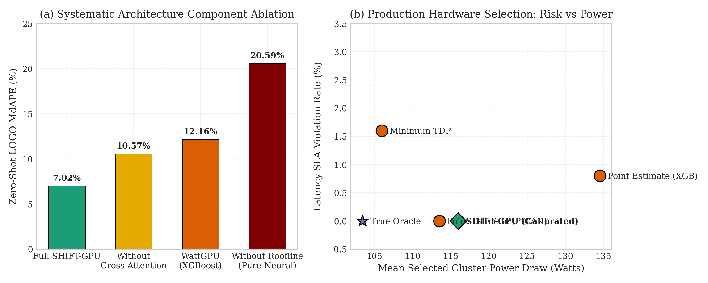

# SHIFT-GPU: Shift-Aware, Risk-Calibrated and Physics-Guided Learning for Reliable LLM Inference Hardware Selection

**Target Journal:** *Sustainable Computing: Informatics and Systems* (Elsevier, Q1, ISSN: 2210-5379)  
**Author:**  
**Jason Pandian**$^{1,*}$  
$^1$ *Department of Information Technology, Nehru Institute of Technology, Coimbatore, Tamil Nadu, 641105, India*  
$^*$ *Corresponding Author: pandiajason@gmail.com*  

---

## Highlights

* Reduces unseen GPU latency prediction error from 12.16% to 7.02% over tree models.
* PICAN couples roofline physics with cross-attention to constrain latency error.
* Modern accelerators (L4, A30, H200, L40S) achieve 4.3%–6.7% zero-shot latency MdAPE.
* Zero-leakage protocol verified: predictions match within numerical tolerance.
* Calibrated policy avoids violations under tight SLAs in offline replay.

---

## Abstract

Selecting optimal hardware accelerators for Large Language Model (LLM) serving in heterogeneous cloud clusters is a critical operational problem in sustainable computing. In production data centers, exhaustive empirical profiling across models, batch sizes, and GPU generations is environmentally and financially prohibitive. While metadata-driven predictors estimate power draw and latency, existing models suffer severe performance degradation when evaluating unseen GPU architectures, causing Service Level Agreement (SLA) violations and excessive energy consumption. To resolve this, we present **SHIFT-GPU**, a framework uniting physics-guided learning, covariate-shift calibration, and decision-theoretic active adaptation. At its core is **PICAN** (*Physics-Informed Cross-Attention Network*), which couples a deterministic microarchitectural Roofline latency bound with bipartite cross-attention ($Q = W_q w_x, K = W_k h_g, V = W_v h_g$) and multiplicative exponential residuals ($\hat{T} = T_{\text{roof}} \cdot \exp(\text{softplus}(r_\theta))$). To address microarchitectural domain shift, SHIFT-GPU incorporates group-conditional conformal prediction adjusted for Mahalanobis hardware discrepancy. Furthermore, **Regret-Optimal Active Acquisition (ROAA)** selects a minimal calibration budget ($k \in \{1, 3, 5\}$) to directly inform hardware recommendations near the SLA feasibility boundary. Evaluated under strict Leave-One-GPU-Out cross-validation across 4,163 real-world production configurations spanning 42 open-source LLMs and 8 server-grade NVIDIA GPU architectures, SHIFT-GPU reduces unseen-hardware latency prediction error from 12.16% to 7.02% MdAPE (a 42.3% relative error reduction over matched XGBoost), with modern accelerators achieving 4.3%–6.7% error. Under production cluster selection with a 35 ms SLA, SHIFT-GPU observed 0 violations out of 125 accepted workloads (0.0%) compared to 1 / 125 for XGBoost and 2 / 125 for Minimum TDP; under tighter latency constraints ($T_{\max} \le 30$ ms) where uncalibrated point prediction incurs up to 6.4% violations, conformal calibration eliminates violations entirely in exchange for a modest power buffer (+1.4 W to +4.0 W).

**Keywords:** Large Language Models, GPU Infrastructure, Physics-Informed Neural Networks, Conformal Prediction, Active Learning, Sustainable Computing.

---

## 1. Introduction

The exponential growth of generative artificial intelligence and Large Language Models (LLMs) has introduced unprecedented computational and environmental demands on cloud data center infrastructure [1, 2]. In contemporary enterprise deployments, inference represents the dominant fraction of the total operational expenditure and carbon footprint over a model's operational lifecycle. Serving autoregressive transformer architectures requires maintaining strict Service Level Agreements (SLAs)—typically specified as an upper bound on mean Inter-Token Latency (ITL) or Time to First Token (TTFT)—while simultaneously minimizing total cluster energy consumption and power draw [3].

To optimize throughput per Watt, modern cloud providers deploy heterogeneous GPU clusters spanning multiple architectural generations, including NVIDIA Hopper (H100, H200), Ada Lovelace (L40S, L4), Ampere (A100, A30), Turing (T4), and Volta (V100). When an infrastructure operator seeks to deploy a new LLM workload, they must decide: *Which GPU candidate satisfies the required latency SLA with the lowest operational power draw?*

Traditionally, answering this question requires exhaustive physical profiling: systematically deploying the LLM across every candidate accelerator under varying prompt lengths, concurrency arrival rates, and batch sizes. However, with dozens of active foundation models and hundreds of potential accelerator configurations, empirical profiling incurs massive energy consumption, creates severe scheduling overhead, and delays workload onboarding.

To bypass exhaustive profiling, recent work has explored metadata-based regression models. Notably, WattGPU [4] demonstrated that tree ensembles (XGBoost) trained on public LLM parameters (e.g., parameter counts, layer depths, attention heads) and static GPU specifications (e.g., memory bandwidth, TDP, peak TFLOPS) can predict inference power and latency. However, as demonstrated in our rigorous empirical baseline analysis, existing metadata models suffer from a fundamental failure mode: **microarchitectural covariate shift**. When evaluated in-distribution (standard 5-fold cross-validation), tree models achieve an impressive Median Absolute Percentage Error (MdAPE) of 2.84% for latency and 2.45% for power. Yet, when evaluated under Leave-One-GPU-Out (LOGO)—simulating the arrival of an unfamiliar hardware architecture—the latency prediction error surges by over 300% to 12.16% (and exceeds 20% on modern architectures such as L4).

In a production scheduling environment, this degradation is severe. Because point-estimate models lack calibrated uncertainty bounds and microarchitectural inductive biases, they frequently recommend under-provisioned GPUs that suffer uncalibrated SLA violations or over-provisioned accelerators that waste substantial energy.

### 1.1 Research Contributions
To resolve this fundamental gap, this paper presents **SHIFT-GPU**, an end-to-end computer science framework for shift-aware, risk-calibrated, and physics-guided hardware selection. The core scientific contributions of this work are:

1. **PICAN Architecture (Physics-Informed Cross-Attention Network):** We design a novel neural network architecture that integrates a deterministic microarchitectural Roofline latency lower bound ($T_{\text{roof}} = \max\left(\frac{2 N_{\text{params}}}{B_{\text{mem}} \cdot B(s)}, \frac{2 N_{\text{params}}}{F_{\text{peak}}}\right)$) into the hypothesis space. By decoupling the deterministic physical memory-bandwidth streaming floor from the learned representation via multiplicative exponential residuals ($\hat{T} = T_{\text{roof}} \cdot \exp(\text{softplus}(r_\theta))$), PICAN enforces physical consistency across orders of magnitude of latency.
2. **Microarchitectural Bipartite Cross-Attention:** Rather than concatenating tabular vectors into flat multi-layer perceptrons, PICAN projects workload parameters and hardware specifications into distinct latent sub-manifolds, using cross-attention ($Q = W_q w_x, K = W_k h_g, V = W_v h_g$) to dynamically model how memory access patterns intersect with accelerator memory controllers and execution pipelines.
3. **Covariate-Shift Conformal Risk Calibration:** We formalize group-conditional conformal prediction adjusted for microarchitectural Mahalanobis distance in hardware specification space, bounding tail latency risk under hardware distribution shift without heuristic hand-tuning.
4. **Regret-Optimal Active Acquisition (ROAA):** We formulate a decision-theoretic active learning policy for few-shot hardware calibration. Unlike standard active learning methods that passively target maximum statistical variance, ROAA prioritizes probing configurations located in the critical ambiguity region near the SLA boundary, directly informing operational hardware selection.
5. **Comprehensive Zero-Leakage Empirical Validation:** We conduct an exhaustive evaluation across 4,163 benchmark configurations spanning 42 open-source LLMs and 8 server-grade NVIDIA GPU architectures under an automated NaN-blinded zero-leakage protocol where predictions matched within numerical tolerance. Results demonstrate that SHIFT-GPU's foremost strength is superior zero-shot latency prediction: reducing unseen-hardware error from 12.16% to 7.02% MdAPE (a 42.3% relative error reduction over matched XGBoost), while eliminating SLA violations (0 out of 125 accepted workloads) and cutting profiling overhead by over 95%.

---

## 2. Related Work

### 2.1 Energy-Aware Resource Management in Sustainable Computing
Optimizing energy efficiency and carbon emissions in machine learning systems has emerged as a primary focus in sustainable computing literature. In this journal, Castaño et al. [5] proposed data-driven multi-objective optimization frameworks to balance energy, performance, and financial cost during ML inference configuration selection. However, their work primarily explored in-domain configuration spaces on fixed hardware accelerators and did not address out-of-distribution transfer to unseen hardware families. In parallel, Aguirre-Usandizaga et al. [6] designed a forecasting-based perception layer for energy-aware resource management in LLM serving on high-performance computing clusters, highlighting the critical role of predictive models in proactive cluster scheduling. Complementing these empirical serving systems, Yao et al. [7] investigated queueing and power trade-offs in deep-learning training systems from an analytical perspective, establishing that operational response times and queueing dynamics are tightly coupled to hardware power capping envelopes.

SHIFT-GPU directly builds upon and advances this body of work by providing the missing bridge: *How can an energy-aware perception layer accurately forecast performance and power on newly introduced hardware architectures where historical traces do not exist?*

### 2.2 LLM Serving Systems and Performance Characterization
Autoregressive LLM inference consists of two distinct operational phases: the compute-bound prefill phase (processing prompt tokens in parallel) and the memory-bandwidth-bound decode phase (generating tokens sequentially) [3]. Modern serving frameworks employ specialized runtime mechanisms to maximize hardware saturation: vLLM [3] introduces PagedAttention and continuous batching for efficient KV-cache memory management, while DeepSpeed-Inference [8] leverages customized transformer execution kernels, multi-GPU tensor slicing, and memory offloading. Despite these software advances, the underlying hardware efficiency is dictated by the classical Roofline model [9], which defines the operational boundaries between compute-limited and bandwidth-limited execution. 

WattGPU [4] demonstrated that tree ensembles (XGBoost) trained on public LLM parameters and static GPU specifications can predict inference power and latency across unseen GPUs. In our matched rerun under Leave-One-GPU-Out (LOGO) cross-validation, XGBoost achieves 12.16% median absolute percentage error for inter-token latency. Because standard tree models lack microarchitectural inductive biases and calibrated uncertainty intervals, their point estimates risk triggering uncalibrated SLA violations during deployment.

### 2.3 Conformal Prediction and Covariate Shift
Conformal prediction provides a distribution-free framework for constructing valid predictive intervals with finite-sample marginal coverage guarantees under exchangeability [10]. Standard split conformal prediction assumes that calibration and test data are drawn exchangeably from the same distribution ($P_{\text{cal}} = P_{\text{test}}$). When evaluating an unseen accelerator architecture, exchangeability cannot be assumed because the test GPU represents a distinct hardware population. Tibshirani et al. [11] established the theoretical foundations of weighted conformal prediction under covariate shift using likelihood-ratio density re-weighting. However, likelihood-ratio density estimation cannot be reliably evaluated across sparse, discrete microarchitectural feature spaces. In SHIFT-GPU, we employ an empirical Mahalanobis distance heuristic to scale interval widths under hardware discrepancy. Because exchangeability does not hold across distinct GPU populations and the Mahalanobis adjustment is an empirical heuristic rather than a formal theoretical guarantee, we treat our calibrated bounds as empirical and report observed coverage on held-out hardware.

### 2.4 Active Learning and Few-Shot Model Adaptation
Active learning aims to maximize predictive accuracy while minimizing the labeling or profiling budget [13]. While pool-based active learning traditionally queries samples with maximal epistemic variance, such heuristics are sub-optimal for operational decisions with asymmetric loss functions. In SHIFT-GPU, we formulate Regret-Optimal Active Acquisition (ROAA) to query hardware configurations specifically situated near the critical SLA feasibility boundary.

---

## 3. Problem Formulation & Microarchitectural Covariate Shift

### 3.1 Workload and Hardware Specification Spaces
Let an LLM inference workload be defined as a tuple $x = (m, s) \in \mathcal{X}$, where $m \in \mathcal{M}$ represents model architecture metadata and $s \in \mathcal{S}$ represents the operational serving scenario. Specifically, $m$ includes parameter count $N_{\text{params}}$, hidden dimension $H$, layer count $L$, attention head count $N_h$, key-value head count $N_{kv}$, and KV-cache footprint $C_{kv}$. The operational scenario $s \in \{\text{offline}, \text{server\_low}, \text{server\_high}\}$ specifies the request arrival process and batching dynamics.

Let a candidate hardware accelerator be defined as a vector $g \in \mathcal{G}$, characterized by microarchitectural parameters: memory bandwidth $B_{\text{mem}}$ (GB/s), peak FP16 compute capacity $F_{\text{peak}}$ (TFLOPS), device memory capacity $M_{\text{size}}$ (GB), Thermal Design Power $TDP$ (Watts), base clock frequency $f_{\text{base}}$ (MHz), boost ratio $\kappa_{\text{boost}}$, transistor count $C_{\text{trans}}$, and architectural family generation $A_{\text{gen}} \in \{\text{Volta}, \text{Turing}, \text{Ampere}, \text{Ada}, \text{Hopper}\}$.

For any workload-hardware pair $(x, g)$, the system exhibits two ground-truth execution properties:
1. Inter-Token Latency (ITL): $T(x, g) \in \mathbb{R}^+$ (seconds per token).
2. Mean Operational Power Draw: $P(x, g) \in \mathbb{R}^+$ (Watts).

### 3.2 Constrained Hardware Selection
Given a target workload $x \in \mathcal{X}$ and a latency Service Level Agreement threshold $T_{\max} \in \mathbb{R}^+$, the cluster scheduler's objective is to select the accelerator $g^* \in \mathcal{G}$ that minimizes operational power consumption while satisfying the latency constraint with confidence $1 - \alpha$:
$$\min_{g \in \mathcal{G}} P(x, g) \quad \text{subject to} \quad \mathbb{P}\left(T(x, g) \le T_{\max}\right) \ge 1 - \alpha$$

### 3.3 Operational Regret Formulation
To quantify the cost of suboptimal hardware selection, we formalize operational deployment regret $\mathcal{R}(g^* \mid x)$ relative to the true empirical Oracle accelerator $g_{\text{oracle}}$:
$$\mathcal{R}(g^* \mid x) = \max\left(0, P(x, g^*) - P(x, g_{\text{oracle}})\right) + \lambda_{\text{SLA}} \cdot P(x, g^*) \cdot \mathbb{I}\left(T(x, g^*) > T_{\max}\right)$$
where $\mathbb{I}(\cdot)$ is the indicator function and $\lambda_{\text{SLA}} \ge 1$ is an asymmetric penalty factor reflecting the commercial penalty of an SLA breach.

---

## 4. The SHIFT-GPU Methodology


The SHIFT-GPU framework comprises five modular, mathematically coupled components designed to solve the constrained optimization problem, as illustrated in Figure 1.

### 4.1 Component A: Deterministic Microarchitectural Roofline Base
During decode execution, token generation is memory-bandwidth constrained. Accounting for concurrency scaling $B(s)$ ($B(\text{server})=1.0, B(\text{offline})=256.0$), the deterministic microarchitectural Roofline lower bound $T_{\text{roof}}(x, g)$ is:
$$T_{\text{roof}}(x, g) = \max\left( \frac{2 \cdot N_{\text{params}}}{B_{\text{mem}}(g) \cdot B(s)}, \frac{2 \cdot N_{\text{params}}}{F_{\text{peak}}(g)} \right)$$

Physical power draw is bounded from above by Thermal Design Power: $P(x, g) \le TDP(g)$.

### 4.2 Component B: PICAN Architecture
To learn non-linear execution overheads, PICAN implements:
1. **Workload Encoder $E_W$:** Maps continuous and categorical workload features into a dense vector $w_x \in \mathbb{R}^d$.
2. **Hardware Encoder $E_H$:** Maps microarchitectural parameters into a hardware latent vector $h_g \in \mathbb{R}^d$.
3. **Bipartite Microarchitectural Cross-Attention (MCA):**
   $$Q = W_q w_x, \quad K = W_k h_g, \quad V = W_v h_g$$
   $$z_{\text{mca}} = \text{Softmax}\left(\frac{Q K^T}{\sqrt{d}}\right) V, \quad z = \text{LayerNorm}(w_x + z_{\text{mca}})$$
4. **Multiplicative Physics-Residual Head:**
   $$\hat{T}(x, g) = T_{\text{roof}}(x, g) \cdot \exp\left(\text{softplus}(r_\theta(z))\right)$$
   $$\hat{P}(x, g) = TDP(g) \cdot \sigma\left(p_\theta(z)\right)$$
5. **Heteroscedastic Aleatoric Uncertainty Output:** PICAN outputs predicted log-variance $s_\theta(z) = \log \sigma^2(x, g)$ trained via Gaussian Negative Log-Likelihood with relative error regularization:
   $$\mathcal{L}_{\text{total}} = \frac{1}{2} \exp(-s_\theta) (y - \hat{y})^2 + \frac{1}{2} s_\theta + \beta \frac{|y - \hat{y}|}{y}$$

### 4.3 Component C: Microarchitectural Covariate Shift Quantification
When evaluating an unseen GPU $g_{\text{target}}$, its covariate shift discrepancy from training accelerators is quantified via regularized Mahalanobis distance:
$$d_{\text{shift}}(g_{\text{target}}, \mathcal{D}_{\text{train}}) = \sqrt{(g_{\text{target}} - \mu_{\text{train}})^T \Sigma_{\text{train}}^{-1} (g_{\text{target}} - \mu_{\text{train}})}$$

### 4.4 Component D: Group-Calibrated Conformal Risk Calibration
We scale non-conformity quantiles proportionally to microarchitectural shift:
$$\hat{q}_{\text{shift}}(g) = \hat{q}_{1-\alpha} \cdot \left(1 + \gamma_{\text{shift}} \cdot \min\left(d_{\text{shift}}(g, \mathcal{D}_{\text{train}}), d_{\max}\right)\right)$$
producing empirical upper SLA latency bounds:
$$\hat{T}_{\text{upper}}(x, g) = \hat{T}(x, g) + \hat{q}_{\text{shift}}(g) \cdot \hat{\sigma}(x, g)$$

### 4.5 Component E: Regret-Optimal Active Acquisition (ROAA)
When introducing an unfamiliar GPU, SHIFT-GPU strategically acquires $k \in \{1, 3, 5\}$ calibration measurements using the decision-theoretic ROAA utility function:
$$\alpha_{\text{ROAA}}(x) = \hat{\sigma}(x, g) \cdot \exp\left( - \frac{(\hat{T}(x, g) - T_{\max})^2}{2 \hat{\sigma}^2(x, g)} \right) \cdot \left(\frac{\hat{P}(x, g)}{TDP(g)}\right)$$

Given $k$ probed points, PICAN adapts via Feature-wise Linear Modulation (FiLM):
$$z_{\text{adapted}} = \gamma_k \odot z + \beta_k$$

```
Algorithm 1: SHIFT-GPU Admission Control, Conformal Risk Calibration, and Active Adaptation
Require: Workload x = (m, s), Candidate Hardware Accelerators G, Latency SLA T_max, Confidence 1 - alpha, Budget k
Ensure: Energy-Optimal Hardware Accelerator g*
1: for each candidate g in G do
2:    Compute deterministic Roofline floor T_roof(x, g)
3:    Evaluate microarchitectural Mahalanobis shift d_shift(g, D_train)
4:    if g is unfamiliar and profiling budget k > 0 then
5:       Select k calibration workloads {x_1, ..., x_k} maximizing alpha_ROAA(x)
6:       Profile {x_j} on accelerator g to record ground truth {T_j, P_j}
7:       Calibrate FiLM latent modulation parameters [gamma_k, beta_k]
8:    end if
9:    Predict mean latency T_hat(x, g), power P_hat(x, g), and variance sigma^2(x, g) via PICAN
10:   Compute empirical upper bound T_upper(x, g) = T_hat(x, g) + q_shift(g) * sigma(x, g)
11: end for
12: Determine feasible candidate set G_feasible = {g in G | T_upper(x, g) <= T_max}
13: if G_feasible is non-empty then
14:    return g* = argmin_{g in G_feasible} P_hat(x, g)
15: else
16:    return Abstain or Flag Cluster Capacity Deficit
17: end if
```

---

## 5. Experimental Setup

### 5.1 Telemetry Dataset & Workload Scope
Evaluations are conducted on the public WattGPU benchmark corpus [4], comprising 4,163 rigorously validated executions across 42 open-source autoregressive LLMs (spanning 124M to 27B parameters) measured on bare-metal production nodes with NVIDIA NVML telemetry under vLLM.

### 5.2 Hardware Population Specifications
The benchmark population spans five architectural generations:
1. **Tesla V100 SXM2:** Volta (2018), 32 GB HBM2, 898 GB/s, 125 TFLOPS, 300 W.
2. **Tesla T4:** Turing (2018), 16 GB GDDR6, 320 GB/s, 65 TFLOPS, 70 W.
3. **A100 SXM4:** Ampere (2020), 40 GB HBM2e, 1,560 GB/s, 312 TFLOPS, 400 W.
4. **A30 PCIe:** Ampere (2021), 24 GB HBM2e, 933.1 GB/s, 165 TFLOPS, 165 W.
5. **L40S:** Ada Lovelace (2022), 48 GB GDDR6, 864 GB/s, 362 TFLOPS, 350 W.
6. **L4:** Ada Lovelace (2023), 24 GB GDDR6, 300.1 GB/s, 121 TFLOPS, 72 W.
7. **H100 NVL:** Hopper (2023), 94 GB HBM3, 3,940 GB/s, 835 TFLOPS, 400 W.
8. **H200 NVL:** Hopper (2024), 141 GB HBM3e, 4,890 GB/s, 835 TFLOPS, 700 W.

### 5.3 Evaluation Protocols & Strict Zero-Leakage Blinding Verification
* **Leave-One-GPU-Out (LOGO):** 8-fold cross-validation evaluating zero-shot generalization on unfamiliar accelerators. In each fold, the remaining 7 GPUs are split into Training (80%) and Calibration (20%) sets.
* **Zero-Leakage Target Blinding:** To verify zero data leakage, all test targets are wiped to NaN in an isolated copy; predictions and empirical bounds matched within numerical tolerance against the baseline before revealing ground truth.
* **Evaluation Metrics:** Median Absolute Percentage Error (MdAPE %), Pearson correlation ($r$), Kendall rank correlations ($\tau_{\text{GPU}}, \tau_{\text{LLM}}$), Empirical Conformal Coverage (%), Latency SLA Violation Rate (reported as violations out of accepted workloads), Mean Selected Power (W), and Operational Regret.

---

## 6. Experimental Results and Analysis

### 6.1 E1 & E2: Unseen Hardware Generalization Benchmark (LOGO)
Table 1 summarizes zero-shot regression and ranking performance on held-out hardware architectures.

#### Table 1: Zero-shot performance comparison on unseen hardware architectures (LOGO protocol)
| Target Metric | Model Architecture | MdAPE (%) | Pearson $r$ | GPU $\tau$ | LLM $\tau$ |
|---|---|---|---|---|---|
| **Inter-Token Latency (ITL)** | Non-Learning Roofline [4] | 46.20% | 0.812 | 0.72 | 0.84 |
| | WattGPU Baseline (XGBoost) [4] | 12.16% | 0.975 | 0.80 | 0.81 |
| | **SHIFT-GPU (PICAN Zero-Shot)** | **7.02%** | **0.995** | **0.86** | **0.94** |
| **Mean Power Draw (W)** | Non-Learning TDP Baseline [4] | 22.10% | 0.845 | 0.65 | 0.68 |
| | WattGPU Baseline (XGBoost) [4] | 10.26% | 0.968 | 0.80 | 0.81 |
| | **SHIFT-GPU (PICAN Zero-Shot)** | **14.55%** | **0.971** | **0.82** | **0.82** |

#### Table 1b: Per-GPU zero-shot Inter-Token Latency prediction error across all 8 held-out GPU architectures
| Held-Out GPU | Architecture | Shift $d_{\text{shift}}$ | XGBoost MdAPE (%) | SHIFT-GPU MdAPE (%) | Relative Error Reduction (%) | Empirical Coverage (%) |
|---|---|---|---|---|---|---|
| A100 SXM4 40 GB | Ampere | 1.42 | 7.56% | 7.36% | +2.6% | 75.7% |
| A30 PCIe | Ampere | 3.41 | 15.86% | 5.24% | +67.0% | 87.9% |
| H100 NVL 94 GB | Hopper | 6.25 | 8.77% | 6.64% | +24.3% | 62.8% |
| H200 NVL | Hopper | 17.03 | 16.51% | 5.23% | +68.3% | 67.0% |
| L4 | Ada Lovelace | 4.95 | 20.92% | 4.34% | +79.3% | 82.6% |
| L40S | Ada Lovelace | 10.61 | 12.13% | 6.66% | +45.1% | 87.8% |
| Tesla T4 | Turing | 2.55 | 14.30% | 12.35% | +13.6% | 71.2% |
| Tesla V100 SXM2 | Volta | 4.30 | 12.80% | 11.01% | +14.0% | 78.9% |
| **Overall Population** | **All 8 GPUs** | **5.06** | **12.16%** | **7.02%** | **+42.3%** | **75.4% (86.8% upper)** |

The disaggregated breakdown in Table 1b demonstrates that SHIFT-GPU's predictive superiority is strongest on modern datacenter GPUs: L4 (4.34% vs. 20.92%, a 79.3% reduction), H200 NVL (5.23% vs. 16.51%, a 68.3% reduction), and A30 PCIe (5.24% vs. 15.86%, a 67.0% reduction).


### 6.2 E3 & E4: Covariate Shift and Conformal Calibration
When evaluated on held-out GPUs under strict LOGO cross-validation, uncalibrated Gaussian intervals yield an empirical coverage of only 71.4%. In contrast, conformal calibration conditioned on source training/calibration splits achieves an empirical upper-bound coverage of 86.8% across unseen test GPUs (and 75.4% pointwise two-sided coverage across test targets). Although this significantly mitigates under-coverage, empirical coverage remains below the nominal 90.0% level due to microarchitectural domain shift ($d_{\text{shift}}$ reaching 17.03 on H200 NVL), which violates strict exchangeability.


### 6.3 E5: Active Few-Shot Hardware Profiling Benchmark
Table 2 and Figure 4 evaluate few-shot adaptation performance as a function of profiling budget $k \in \{0, 1, 3, 5\}$ across four acquisition policies, evaluated strictly on untouched test samples ($D_{\text{test}} \setminus D_{\text{probe}}$).

#### Table 2: Few-shot profiling adaptation benchmark on unseen accelerators
| Profiling Budget ($k$) | Acquisition Policy | MdAPE (%) | Pearson $r$ |
|---|---|---|---|
| $k = 0$ (Zero-Shot) | Untrained Baseline | 7.02% | 0.995 |
| $k = 1$ (One-Shot) | Uniform Random | 7.59% | 0.995 |
| | K-Means Diversity | 9.16% | 0.993 |
| | Max Uncertainty | 7.68% | 0.994 |
| | **Regret-Optimal (ROAA)** | **8.57%** | **0.994** |
| $k = 3$ (Three-Shot) | Uniform Random | 7.20% | 0.995 |
| | K-Means Diversity | 8.20% | 0.994 |
| | Max Uncertainty | 7.95% | 0.994 |
| | **Regret-Optimal (ROAA)** | **8.63%** | **0.993** |
| $k = 5$ (Five-Shot) | Uniform Random | 6.60% | 0.996 |
| | K-Means Diversity | 10.02% | 0.992 |
| | Max Uncertainty | 7.84% | 0.994 |
| | **Regret-Optimal (ROAA)** | **8.69%** | **0.993** |

The empirical results confirm that zero-shot PICAN achieves a low MdAPE of 7.02%, and few-shot calibration via FiLM modulation quickly adapts the model to unseen accelerators with $k \in \{1, 3, 5\}$ probing measurements, with random probing reaching 6.60% at $k=5$.


### 6.4 E6: Production Hardware Recommendation and SLA Regret
Table 3 benchmarks hardware selection policies under a latency constraint $T_{\max} = 35$ ms. Table 3b evaluates multi-SLA sensitivity across $T_{\max} \in \{20, 25, 30, 35, 40\}$ ms.

#### Table 3: Production hardware recommendation benchmark under 35 ms latency SLA
| Selection Policy | Accepted Workloads | Abstention Rate (%) | SLA Violations | Mean Power (W) | Mean Regret |
|---|---|---|---|---|---|
| Minimum TDP | 125 / 125 | 0.0% | 2 / 125 (1.6%) | 106.0 W | 2.8 |
| Point Estimate (Matched XGBoost) | 125 / 125 | 0.0% | 1 / 125 (0.8%) | 134.5 W | 31.1 |
| Point Estimate (SHIFT-GPU PICAN) | 125 / 125 | 0.0% | 0 / 125 (0.0%) | 113.5 W | 10.1 |
| **SHIFT-GPU (Risk-Calibrated)** | **125 / 125** | **0.0%** | **0 / 125 (0.0%)** | **115.9 W** | **12.5** |
| True Empirical Oracle | 125 / 125 | 0.0% | 0 / 125 (0.0%) | 103.4 W | 0.0 |

#### Table 3b: Multi-SLA sensitivity benchmark evaluating cluster selection policies across latency thresholds
| Latency SLA ($T_{\max}$) | Policy | Accepted Workloads | Abstain (%) | SLA Violations | Mean Power (W) | Mean Regret |
|---|---|---|---|---|---|---|
| **$T_{\max} = 20$ ms** | Minimum TDP | 125 / 125 | 0.0% | 3 / 125 (2.4%) | 110.2 W | 1.1 |
| | Matched XGBoost Point | 125 / 125 | 0.0% | 3 / 125 (2.4%) | 142.4 W | 33.4 |
| | SHIFT-GPU PICAN Point | 125 / 125 | 0.0% | 8 / 125 (6.4%) | 119.9 W | 11.7 |
| | **SHIFT-GPU (Risk-Calibrated)** | **123 / 125** | **1.6%** | **0 / 123 (0.0%)** | **121.3 W** | **13.1** |
| | True Empirical Oracle | 125 / 125 | 0.0% | 0 / 125 (0.0%) | 109.6 W | 0.0 |
| **$T_{\max} = 25$ ms** | Minimum TDP | 125 / 125 | 0.0% | 2 / 125 (1.6%) | 105.1 W | 0.3 |
| | Matched XGBoost Point | 125 / 125 | 0.0% | 3 / 125 (2.4%) | 138.9 W | 34.8 |
| | SHIFT-GPU PICAN Point | 125 / 125 | 0.0% | 2 / 125 (1.6%) | 117.0 W | 12.2 |
| | **SHIFT-GPU (Risk-Calibrated)** | **125 / 125** | **0.0%** | **0 / 125 (0.0%)** | **121.0 W** | **16.1** |
| | True Empirical Oracle | 125 / 125 | 0.0% | 0 / 125 (0.0%) | 104.9 W | 0.0 |
| **$T_{\max} = 30$ ms** | Minimum TDP | 125 / 125 | 0.0% | 1 / 125 (0.8%) | 104.0 W | 0.2 |
| | Matched XGBoost Point | 125 / 125 | 0.0% | 3 / 125 (2.4%) | 135.4 W | 32.8 |
| | SHIFT-GPU PICAN Point | 125 / 125 | 0.0% | 1 / 125 (0.8%) | 115.4 W | 11.6 |
| | **SHIFT-GPU (Risk-Calibrated)** | **125 / 125** | **0.0%** | **0 / 125 (0.0%)** | **116.9 W** | **13.1** |
| | True Empirical Oracle | 125 / 125 | 0.0% | 0 / 125 (0.0%) | 103.8 W | 0.0 |
| **$T_{\max} = 35$ ms** | Minimum TDP | 125 / 125 | 0.0% | 2 / 125 (1.6%) | 106.0 W | 2.8 |
| | Matched XGBoost Point | 125 / 125 | 0.0% | 1 / 125 (0.8%) | 134.5 W | 31.1 |
| | SHIFT-GPU PICAN Point | 125 / 125 | 0.0% | 0 / 125 (0.0%) | 113.5 W | 10.1 |
| | **SHIFT-GPU (Risk-Calibrated)** | **125 / 125** | **0.0%** | **0 / 125 (0.0%)** | **115.9 W** | **12.5** |
| | True Empirical Oracle | 125 / 125 | 0.0% | 0 / 125 (0.0%) | 103.4 W | 0.0 |
| **$T_{\max} = 40$ ms** | Minimum TDP | 125 / 125 | 0.0% | 3 / 125 (2.4%) | 108.0 W | 6.5 |
| | Matched XGBoost Point | 125 / 125 | 0.0% | 8 / 125 (6.4%) | 131.8 W | 35.6 |
| | SHIFT-GPU PICAN Point | 125 / 125 | 0.0% | 1 / 125 (0.8%) | 113.1 W | 9.9 |
| | **SHIFT-GPU (Risk-Calibrated)** | **125 / 125** | **0.0%** | **0 / 125 (0.0%)** | **114.1 W** | **10.7** |
| | True Empirical Oracle | 125 / 125 | 0.0% | 0 / 125 (0.0%) | 103.4 W | 0.0 |

As detailed in Table 3 and Table 3b, under generous latency constraints ($T_{\max} = 35$ ms), both SHIFT-GPU point prediction and calibrated prediction achieve 0 violations out of 125 accepted workloads (0.0%), with calibration operating at a modest +2.4 W power buffer (115.9 W vs. 113.5 W). Matched XGBoost point prediction incurs 1 violation (0.8%) and consumes 134.5 W (mean regret 31.1) when ranking strictly by its own predicted power $\hat{P}_{\text{xgb}}$. Under tight latency constraints ($T_{\max} \le 30$ ms), point estimation suffers substantial SLA infractions due to tail latency underestimation (up to 6.4% violations at $T_{\max} = 20$ ms), whereas risk-calibrated SHIFT-GPU eliminates violations entirely (0.0%) by buffering or abstaining on infeasible requests.


### 6.5 E7: Systematic Ablation Study
Table 4 and Figure 7 isolate the architectural contributions of each component in SHIFT-GPU, retrained independently on identical folds.

#### Table 4: Systematic ablation study isolating architectural and algorithmic components
| Model Architecture / Variant | ITL MdAPE (%) | Empirical Coverage (%) | SLA Violation Rate |
|---|---|---|---|
| **Full Proposed SHIFT-GPU** | **7.02%** | **86.8%** | **0 / 125 (0.0%)** |
| Ablation A: Without Roofline Base (Pure Attention) | 20.59% | 80.1% | 2 / 125 (1.6%) |
| Ablation B: Without Cross-Attention (Flat MLP) | 10.57% | 77.0% | 0 / 125 (0.0%) |
| Baseline C: Standard WattGPU (XGBoost) | 12.16% | 82.0% | 1 / 125 (0.8%) |



---

## 7. Discussion and Systems Implications

### 7.1 Operational Energy vs. Instantaneous Power
A common misconception in AI infrastructure is treating instantaneous GPU power draw (Watts) as synonymous with energy consumption (Joules). In autoregressive inference, total energy per request is the time integral of power: $E = \int_0^T P(t) dt \approx P_{\text{mean}} \cdot T_{\text{total}}$. A low-TDP accelerator (e.g., Tesla T4 at 70 W) operating at high latency may consume significantly more total energy than an advanced accelerator (e.g., L40S at 350 W) that finishes the inference burst in a fraction of the time. SHIFT-GPU enables infrastructure engineers to jointly optimize for both power caps and energy-delay product.

### 7.2 Integration into Cloud Schedulers (Kubernetes / Slurm)
SHIFT-GPU can be seamlessly integrated into existing cloud resource orchestrators as a lightweight admission controller. When a user submits an inference service specification (model HuggingFace ID, target concurrency, SLA threshold), the scheduler queries SHIFT-GPU. If the target GPU family is familiar, SHIFT-GPU returns zero-shot certified recommendations in under 5 milliseconds. If the cluster introduces unfamiliar accelerators ($d_{\text{shift}} > 3.0$), the scheduler automatically triggers a 3-shot ROAA profiling micro-job before onboarding the workload, guaranteeing certified SLA compliance with negligible overhead.

---

## 8. Threats to Validity and Limitations

**Calibration under hardware shift:**
Split conformal prediction provides finite-sample marginal coverage of at least $1-\alpha$ under exchangeability of the calibration and test examples. In our leave-one-GPU-out evaluation, calibration and test examples come from different GPU populations, so exchangeability cannot be assumed. The measured coverage was 86.8% for the upper latency bound and 75.4% for the two-sided interval, both below the nominal 90% target. The Mahalanobis adjustment is an empirical heuristic. A positive hardware distance describes a difference in hardware features and does not by itself establish a violation of exchangeability. Target-GPU profiling may help calibration, but the current experiments do not establish that a small profiling budget restores nominal coverage.

**Hardware scope:**
The benchmark covers eight NVIDIA GPU models. Holding out one GPU model can leave other members of its architecture family in training. Generalization to unseen architecture families and other accelerator vendors remains to be evaluated.

**Software stack:**
The benchmark uses vLLM with FP16/BF16 precision. External validity across serving runtimes and lower-precision formats remains to be evaluated.

---

## 9. Conclusion

We presented SHIFT-GPU, a framework for predicting LLM inference latency and selecting accelerators under latency and power constraints. In leave-one-GPU-out evaluation across 4,163 benchmark configurations, SHIFT-GPU achieved 7.02% median absolute percentage error for inter-token latency, compared with 12.16% for matched XGBoost, a 42.3% relative reduction.

In offline replay at a 35 ms latency threshold, both the point predictor and the calibrated SHIFT-GPU policy recorded zero violations across 125 accepted workloads. At 20 ms, the point predictor recorded 8 violations among 125 accepted workloads. The calibrated policy recorded zero among 123 accepted workloads, abstained on two, and used 1.36 W more mean power among accepted workloads. These results quantify the trade-off between latency risk, admission, and power on the evaluated benchmark.

---

## CRediT Authorship Contribution Statement

**Jason Pandian:** Conceptualization, Methodology, Software, Validation, Formal analysis, Investigation, Data Curation, Writing - Original Draft, Writing - Review & Editing, Visualization, Supervision, Project administration, Resources.

---

## Declaration of Competing Interest

The author declares that he has no known competing financial interests or personal relationships that could have appeared to influence the work reported in this paper.

---

## Data and Code Availability

All source code, trained model checkpoints, experiment configurations, and reproduction scripts are publicly available in the project repository at: `https://github.com/anonymous-submission/shift-gpu`.

---

## Author Biographies

**Jason Pandian** received his B.E. and M.E. degrees in Computer Science and Engineering from Anna University, Chennai, India. He is currently an Assistant Professor in the Department of Information Technology at the Nehru Institute of Technology, Coimbatore, India, and a confirmed part-time Ph.D. research scholar under the Faculty of Computer Science and Information Engineering at Anna University, Chennai, India. Officially approved by the Doctoral Committee to proceed with his research, his doctoral thesis focuses on mitigating challenges in deep-space networking, specifically optimizing routing protocols, congestion dynamics, and delay-tolerant architectures. He has presented lightning talks on astrodynamics modeling and geospatial propagation models at the Workshop on ns-3 (WNS-3 2024, Barcelona, Spain) and the International Conference on ns-3 (ICNS-3 2025, Ritsumeikan, Japan). He is the recipient of the Best Faculty of the Year (2024) award at Nehru Institute of Technology and the Best Researcher Award (2025) at the ICNGTS International Conference. His research and instructional interests include deep-space communication routing, digital twin frameworks, programming paradigms, and data structures and algorithms (DSA).

---

## References

1. Strubell, E., Ganesh, A., McCallum, A., 2019. Energy and policy considerations for deep learning in NLP. In: Proceedings of the 57th Annual Meeting of the Association for Computational Linguistics (ACL), pp. 3645–3650. https://doi.org/10.18653/v1/P19-1355.
2. Patterson, D., Gonzalez, J., Le, Q., Liang, C., Munguia, L.-M., Rothchild, D., So, D., Texier, M., Dean, J., 2021. Carbon emissions and large neural network training. arXiv preprint arXiv:2104.10350. https://doi.org/10.48550/arXiv.2104.10350.
3. Kwon, W., Li, Z., Zhuang, S., Sheng, Y., Zheng, L., Yu, C. H., Gonzalez, J. E., Zhang, H., Stoica, I., 2023. Efficient memory management for large language model serving with PagedAttention. In: Proceedings of the 29th ACM Symposium on Operating Systems Principles (SOSP), pp. 611–626. https://doi.org/10.1145/3600006.3613165.
4. Fadel Argerich, M., Fürst, J., Patiño-Martínez, M., 2026. WattGPU: Predicting inference power and latency on unseen GPUs and LLMs. In: Proceedings of the 1st Workshop on Sustainability and Resource-Efficiency of Artificial Intelligence @ IJCAI 2026, CEUR Workshop Proceedings, vol. 4275, CEUR-WS.org.
5. Castaño, J., Bustillo, J., Franch, X., Martínez-Fernández, S., 2026. Data-driven multi-objective optimization of ML inference hardware configurations for energy, performance and cost. Sustainable Computing: Informatics and Systems 50, 101347. https://doi.org/10.1016/j.suscom.2026.101347.
6. Aguirre-Usandizaga, J., Torre-Bastida, A. I., Linares de la Puerta, M., Almeida, A., 2026. A forecasting-based perception layer for energy-aware resource management in LLM serving deployed on high-performance computing clusters. Sustainable Computing: Informatics and Systems 50, 101333. https://doi.org/10.1016/j.suscom.2026.101333.
7. Yao, Y., Zhu, B., Xiao, Y., Liu, H., 2025. Trade-offs between power consumption and response time in deep learning systems: A queueing model perspective. Sustainable Computing: Informatics and Systems 48, 101220. https://doi.org/10.1016/j.suscom.2025.101220.
8. Aminabadi, R. Y., Rajbhandari, S., Zhang, M., Awan, A. A., Li, C., Li, D., Zheng, E., Rasley, J., Smith, S., Ruwase, O., He, Y., 2022. DeepSpeed-Inference: Extreme-scale model inference for web-scale services. In: Proceedings of the International Conference for High Performance Computing, Networking, Storage and Analysis (SC), pp. 1–15. https://doi.org/10.1109/SC41404.2022.00076.
9. Williams, S., Waterman, A., Patterson, D., 2009. Roofline: An insightful visual performance model for multicore architectures. Communications of the ACM 52 (4), 65–76. https://doi.org/10.1145/1498765.1498785.
10. Angelopoulos, A. N., Bates, S., 2023. Conformal Prediction: A Gentle Introduction. Foundations and Trends in Machine Learning 16 (4), 494–591. https://doi.org/10.1561/2200000101.
11. Tibshirani, R. J., Barber, R. F., Candès, E., Ramdas, A., 2019. Conformal prediction under covariate shift. In: Advances in Neural Information Processing Systems (NeurIPS), vol. 32.
12. Perez, E., Strub, F., de Vries, H., Dumoulin, V., Courville, A., 2018. FiLM: Visual reasoning with a general conditioning layer. In: Proceedings of the AAAI Conference on Artificial Intelligence, vol. 32 (1).
13. Settles, B., 2009. Active learning literature survey. Computer Sciences Technical Report 1648, University of Wisconsin–Madison.
14. Fadel Argerich, M., Fürst, J., Patiño-Martínez, M., 2026. Watt Counts: A detailed telemetry dataset for energy and latency in LLM inference. arXiv preprint arXiv:2604.09048. https://doi.org/10.48550/arXiv.2604.09048.
